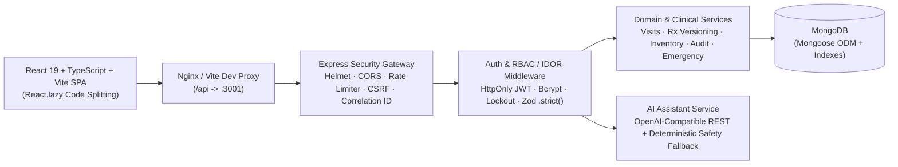
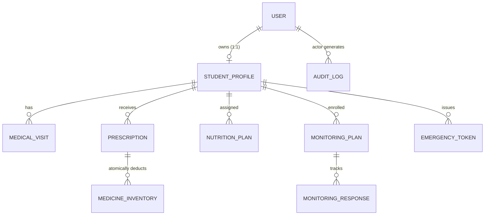

# MedicoAssist — Campus Healthcare Management System

[](https://opensource.org/licenses/MIT)
[]()
[]()
[]()
[]()

**MedicoAssist** is a secure, full-stack Campus Healthcare Management System built for university medical centres. It unifies student health portals, clinical consultations, versioned prescriptions with automated pharmacy inventory deduction, daily symptom monitoring, emergency QR minimum-necessary disclosure, and AI-assisted healthcare education & clinician workflow tools.

---

## 1. System Architecture



---

## 2. Database Entity-Relationship Diagram (ERD)



---

## 3. Core Engineering & Security Controls

| Control | Implementation |
| :--- | :--- |
| **Authentication** | Bcrypt password hashing (`bcryptjs`), fail-fast `JWT_SECRET` validation (`>= 32` chars), HS256 JWTs with `jti` revocation on logout and `tokenVersion` invalidation on role/status changes. |
| **Session & CSRF** | HttpOnly `SameSite=Lax` auth cookie (`campushealth_token`) paired with double-submit CSRF cookie (`XSRF-TOKEN` / `X-CSRF-TOKEN` header verified via `crypto.timingSafeEqual`). |
| **Brute-Force & Rate Limiting** | Account lockout after 5 failed login attempts (15-minute window) + tiered `express-rate-limit` on `/api/` and `/api/auth/`. |
| **RBAC & IDOR Protection** | Strict server-side role checks (`STUDENT`, `MEDICAL_STAFF`, `ADMIN`, `RESEARCHER`, `EMERGENCY_RESPONDER`) and object-level ownership guards (`STUDENT` restricted to own records). |
| **Input Validation & Sanitization** | Strict Zod schemas (`.strict()` rejects unexpected mass-assignment fields), prototype pollution & MongoDB `$`/dot operator sanitization. |
| **Prescription Versioning & Inventory** | Immutable version history (`v1` -> `v2`+) preserving prior versions; prescription issuance and updates atomically deduct dispensed tablet counts from `MedicineInventory`. |
| **Audit Logging & Backups** | Append-only server-side `AuditLog` collection (client-submitted audit writes rejected; Mongoose update/delete hooks blocked) + admin-triggered JSON database backup snapshots. |

---

## 4. AI Integration & Safety Guardrails

MedicoAssist provides a real OpenAI-compatible REST integration (`server/src/services/aiService.js`) with a deterministic clinical/wellness fallback engine when no external `AI_API_KEY` is configured:

- **Healthcare Information Assistant (`POST /api/ai/health-info`)**: Explains clinical terminology, normal vital ranges, and wellness concepts.
- **Nutrition Assistant (`POST /api/ai/nutrition-advice`)**: Generates allergy-aware and preference-aware collegiate meal suggestions.
- **Health Trend Explanation (`POST /api/ai/trend-explanation`)**: Summarizes longitudinal vital changes in plain language.
- **Clinician Visit Summary Draft (`POST /api/ai/visit-summary-draft`)**: Restricted to `MEDICAL_STAFF`; drafts structured consultation notes for physician review and approval.

**Safety Guarantees:** Identifiable student details (emails, roll/ID tokens, phone numbers) are stripped prior to external LLM calls, and every response includes a non-diagnostic medical disclaimer.

---

## 5. API Documentation (OpenAPI / Swagger)

Interactive OpenAPI 3.0 documentation is served directly by the backend:
- **Swagger UI:** `http://localhost:3001/api/docs`
- **Raw OpenAPI JSON:** `http://localhost:3001/api/docs.json`

---

## 6. Getting Started

### Option A: Local Development

1. **Prerequisites:** Node.js `>= 20`, MongoDB running locally on `127.0.0.1:27017`.
2. **Install dependencies:**
   ```bash
   npm install
   cd server && npm install && cd ..
   ```
3. **Configure environment (`server/.env`):**
   ```env
   MONGO_URI=mongodb://127.0.0.1:27017/campushealth
   PORT=3001
   NODE_ENV=development
   JWT_SECRET=<at-least-32-character-random-hex-secret>
   JWT_EXPIRES_IN=1h
   CLIENT_ORIGIN=http://localhost:5173
   # Optional LLM configuration (uses deterministic fallback if omitted)
   # AI_API_KEY=
   # AI_BASE_URL=https://api.openai.com/v1
   # AI_MODEL=gpt-4o-mini
   ```
4. **Run backend & frontend:**
   ```bash
   # Terminal 1 (Backend API)
   cd server && npm start

   # Terminal 2 (Vite Frontend)
   npm run dev
   ```
   Open `http://localhost:5173`.

### Option B: Docker Compose (Production Stack)

```bash
docker compose up --build -d
```
- **Frontend (Nginx):** `http://localhost`
- **Backend API & Swagger:** `http://localhost:3001/api/docs`
- **MongoDB:** `localhost:27017`

---

## 7. Verification & Automated Testing

```bash
# Lint & Strict TypeScript check
npx oxlint
npx tsc -b --noEmit

# Frontend Unit & Component Tests (Vitest + React Testing Library)
npm run test:frontend

# Backend Core, Security, DB & AI Integration Tests
npm run test:backend

# Full Production Build
npm run build
```
